# aerial-autonomy-stack

*Aerial autonomy stack* (AAS)는 필요한 구성요소를 대부분 포함한 개방형 소프트웨어로, 다음 작업을 가장 간단하고 빠르게 수행할 수 있도록 합니다:

1. **개발**: PX4, ArduPilot, ROS2를 이용한 다중 드론 자율비행 개발
2. **시뮬레이션**: YOLO와 3D LiDAR를 이용한 실시간보다 빠른 인지 및 제어 시뮬레이션
3. **실기체 적용**: JetPack, DeepStream, NVIDIA Orin을 이용한 실제 드론 배포

예시 부품 목록은 [`BOM.md`](/tools_and_docs/docs/BOM.md)를, 개발 배경과 필요성은 [`RATIONALE.md`](/tools_and_docs/docs/RATIONALE.md)를 참고하십시오.

https://github.com/user-attachments/assets/57e5bc91-8bee-4bae-8f81-a9aacef471e7

<details>
<summary><b>주요 기능</b> <i>(클릭하여 펼치기)</i></summary>

- **PX4 및 ArduPilot 다중 기체** 시뮬레이션(**쿼드로터, 쿼드플레인 VTOL, 테일시터**)
- ROS2 액션 기반 자동비행장치 인터페이스(XRCE-DDS 또는 MAVROS 사용)
- **YOLO**(ONNX GPU 런타임 사용) 및 **LiDAR** 주행거리 추정([KISS-ICP](https://github.com/PRBonn/kiss-icp) 사용)
- 인지 기반 시뮬레이션을 위한 3D 환경
- 한 단계씩 진행할 수 있는 [Gymnasium 환경](https://gymnasium.farama.org/index.html)과 **실시간보다 빠른**, **다중 인스턴스** 시뮬레이션
- Gazebo의 바람 효과 및 [파도](https://github.com/srmainwaring/asv_wave_sim) 플러그인
- [CUDA 및 cuDNN이 포함된 Ubuntu](https://catalog.ngc.nvidia.com/orgs/nvidia/containers/cuda/tags) 기반의 **Docker 시뮬레이션 환경**
- [DeepStream](https://docs.nvidia.com/metropolis/deepstream/dev-guide/text/DS_Installation.html#platform-and-os-compatibility)을 포함한 [NVIDIA JetPack](https://catalog.ngc.nvidia.com/orgs/nvidia/containers/l4t-jetpack/tags) 기반의 **Docker 실기체 배포 환경**
- WSL을 통한 **Windows 11** 호환
- NVIDIA 및 ARM 기반 기내 컴퓨팅 장치를 시험하기 위한 다중 **Jetson-in-the-loop(HITL) 시뮬레이션**
- 모의 센서 통신(`SIM_SUBNET`)과 기체 간 통신(`AIR_SUBNET`)을 분리하는 이중 네트워크
- 기체 간 ROS2 통신을 위한 [Zenoh](https://github.com/eclipse-zenoh/zenoh-plugin-ros2dds) 브리지
- [PX4 Offboard](https://docs.px4.io/main/en/flight_modes/offboard.html) 인터페이스(예: 민첩한 GNSS 비가용 비행을 위한 CTBR/`VehicleRatesSetpoint`)
- [ArduPilot Guided](https://ardupilot.org/copter/docs/ac2_guidedmode.html) 인터페이스(예: `setpoint_velocity`, `setpoint_accel` 기준값)
- [`flight_review`](https://github.com/PX4/flight_review)(`.ulg`), MAVExplorer(`.bin`), [PlotJuggler](https://github.com/facontidavide/PlotJuggler)(`rosbag`)를 이용한 로그 분석
</details>

## 1. 설치

> AAS는 i7-11, RAM 16GB, RTX 3060 환경의 Ubuntu 24.04 및 `nvidia-driver-580`에서 개발됩니다.
>
> 필요한 구성요소를 설치하려면 [`REQUIREMENTS_UBUNTU.md`](/tools_and_docs/docs/REQUIREMENTS_UBUNTU.md)를 참고하십시오. Windows 11에서는 [`REQUIREMENTS_WSL.md`](/tools_and_docs/docs/REQUIREMENTS_WSL.md)를 참고하십시오.

```sh
sudo apt update && sudo apt install -y git xterm xfonts-base wget unzip

git clone https://github.com/JacopoPan/aerial-autonomy-stack.git
cd aerial-autonomy-stack/tools_and_docs/

./tests/check_requirements.sh                         # AAS에는 nvidia-driver-580, docker, nvidia-container-toolkit이 필요함
./sim_build.sh                                        # 인터넷 연결이 양호한 경우 첫 빌드는 약 45분 소요됨(필요하면 `Ctrl + c`로 중단 후 재시작 가능하며, 캐시된 단계는 유지됨)
```

<details>
<summary><b>ghcr.io 사전 빌드 이미지</b> <i>(클릭하여 펼치기)</i>
<a href="https://github.com/JacopoPan/aerial-autonomy-stack/actions/workflows/aas-amd64-build-and-test.yml"></a>
</summary>

```sh
# ghcr.io 이미지는 매주 금요일 밤 `main` 브랜치를 기준으로 다시 빌드됨
for name in aircraft ground simulation; do
  docker pull ghcr.io/jacopopan/${name}-image:latest
  docker tag ghcr.io/jacopopan/${name}-image:latest ${name}-image:latest
done
```
</details>

## 2. 다중 드론 시뮬레이션


AAS 시작:

```sh
cd aerial-autonomy-stack/tools_and_docs/

NUM_QUADS=1 NUM_VTOLS=1 WORLD=swiss_town RTF=3 PLOT=true ./sim_run.sh    # 시뮬레이션 시작. 추가 옵션은 스크립트를 확인할 것(참고: ArduPilot SITL은 시동 가능 상태가 되기 전 약 30초의 시뮬레이션 시간이 필요함)

# 시뮬레이션 옵션:
#  AUTOPILOT=px4, ardupilot
#  HEADLESS/CAMERA/LIDAR=true, false
#  NUM_QUADS/NUM_VTOLS/NUM_TAILS=0, 1, ...
#  WORLD=impalpable_greyness, apple_orchard, shibuya_crossing, swiss_town, waterworld
#  RTF=1, 2, ... (실시간 배율. 가능한 한 빠르게 실행하려면 0 사용)
#  INSTANCE=0, 1, ... (여러 병렬 시뮬레이션을 실행하기 위한 정수 ID)
#  PLOT=true, false (pymavlink, pyulog, pymap3d 필요)
```

드론을 자율비행시키는 방법은 **3가지**이며, 운용자 감독에는 QGroundControl을 추가로 사용할 수 있습니다.

1. `Ground` 터미널에서 [`dtc_controller_node`](/ground/ground_ws/src/drone_traffic_controller/drone_traffic_controller/dtc_controller_node.py)를 사용하여 모든 드론을 **동기화된 편대**로 비행합니다:
```sh
ros2 run drone_traffic_controller dtc_controller --ros-args -p use_sim_time:=true
```

2. 임의의 `QUAD`/`VTOL`/`TAIL` 터미널에서 각 기체의 **행동 트리 임무**를 실행합니다(예: [`yalla.yaml`](/aircraft/aircraft_resources/missions/yalla.yaml)):
```sh
ros2 run mission mission --conops yalla.yaml --ros-args -r __ns:=/Drone$DRONE_ID -p use_sim_time:=true
```

3. 임의의 `QUAD`/`VTOL`/`TAIL` 터미널에서 [`px4_offboard`](/aircraft/aircraft_ws/src/offboard_control/src/px4_offboard.cpp)/[`ardupilot_guided`](/aircraft/aircraft_ws/src/offboard_control/src/ardupilot_guided.cpp) 제어기에 대한 **ROS2 액션**을 사용합니다:
```sh
cancellable_action "ros2 action send_goal /Drone${DRONE_ID}/takeoff_action \
    autopilot_interface_msgs/action/Takeoff '{takeoff_altitude: 30.0}'"
# Enter를 눌러 액션을 취소하거나, 액션 종료 후 터미널 제어권을 다시 얻음

cancellable_action "ros2 action send_goal /Drone${DRONE_ID}/offboard_action \
    autopilot_interface_msgs/action/Offboard \
    '{controller_name: att-test, max_duration_sec: 10.0}'"
# `px4_offboard.cpp`, `ardupilot_guided.cpp`에서 Offboard 제어기를 추가하거나 다시 구현할 수 있음
```


> `WORLD` 종류:
> *(i)* `apple_orchard`: [BlenderGIS](https://github.com/domlysz/BlenderGIS)를 사용해 만든 GIS 환경
> / *(ii)* `impalpable_greyness`: 단순 도형으로 구성된 빈 환경
> / *(iii)* `shibuya_crossing`: [cgtrader](https://www.cgtrader.com/) 자료를 바탕으로 구성한 3D 환경
> / *(iv)* `swiss_town`: [Pix4D / pix4d.com](https://support.pix4d.com/hc/en-us/articles/360000235126)에서 제공한 사진측량 기반 환경
> / *(v)* `waterworld`: [`asv_wave_sim`](https://github.com/srmainwaring/asv_wave_sim) 파도 플러그인을 사용하는 동적 환경


> [!TIP]
> 센서 매개변수를 변경하려면 [`sensor_config.yaml`](simulation/simulation_resources/aircraft_models/sensor_config.yaml)을 수정한 뒤 `sim_build.sh`를 실행하십시오.
>
> <details>
> <summary>CLI에서 ROS2 드론 및 짐벌 <b>기본 제어 기능</b> 사용 <i>(클릭하여 펼치기)</i></summary>
>
> ```sh
> # 이륙 액션(쿼드로터 및 VTOL/테일시터)
> cancellable_action "ros2 action send_goal /Drone${DRONE_ID}/takeoff_action autopilot_interface_msgs/action/Takeoff '{takeoff_altitude: 40.0, vtol_transition_heading: 330.0, vtol_loiter_north: 200.0, vtol_loiter_east: 100.0, vtol_loiter_alt: 120.0}'"
>
> # 홈 위치 착륙 액션(쿼드로터 및 VTOL/테일시터). 참고: ArduPilot에서는 RTL_ALT/Q_RTL_ALT 매개변수를 덮어씀
> cancellable_action "ros2 action send_goal /Drone${DRONE_ID}/land_action autopilot_interface_msgs/action/Land '{landing_altitude: 60.0, vtol_transition_heading: 60.0}'"
>
> # 선회 액션(쿼드로터 및 VTOL/테일시터). 참고: ArduPilot에서는 CIRCLE_RATE 매개변수를 덮어씀
> cancellable_action "ros2 action send_goal /Drone${DRONE_ID}/orbit_action autopilot_interface_msgs/action/Orbit '{east: 500.0, north: 0.0, altitude: 150.0, radius: 200.0}'"
>
> # 위치 재지정 서비스(쿼드로터만 해당)
> ros2 service call /Drone${DRONE_ID}/set_reposition autopilot_interface_msgs/srv/SetReposition '{east: 50.0, north: 100.0, altitude: 60.0}'
>
> # Offboard 액션(`controller_name`으로 비행 동작 지정. 예: PX4는 "traj-test", ArduPilot은 "vel-test")
> cancellable_action "ros2 action send_goal /Drone${DRONE_ID}/offboard_action autopilot_interface_msgs/action/Offboard '{controller_name: traj-test, max_duration_sec: 5.0}'"
>
> # SetSpeed 서비스(일시적으로 적용되며 자동비행장치 매개변수의 제한을 받음. 쿼드로터는 다음 명령부터 적용되고 ArduPilot VTOL에는 효과 없음)
> ros2 service call /Drone${DRONE_ID}/set_speed autopilot_interface_msgs/srv/SetSpeed '{speed: 3.0}'
>
> # 짐벌 상태 확인 및 위치 제어(라디안 단위)
> ros2 topic echo /gimbal_state
> ros2 topic pub -1 /gimbal_pitch_cmd std_msgs/msg/Float64 "{data: 1.57}"
> ```
> 비행 로그를 분석하려면 `Simulation` 터미널에서 다음을 실행합니다:
> ```sh
> /aas/simulation_resources/scripts/analyze_logs.sh                                           # http://10.42.90.100:5006/browse 또는 MAVExplorer에서 비행 로그 분석
> ```
> </details>
> <details>
> <summary><kbd>Simulation</kbd> 터미널에서 <b>바람 효과</b> 추가 또는 비활성화 <i>(클릭하여 펼치기)</i></summary>
> 
> ```sh
> python3 /aas/simulation_resources/scripts/gz_wind.py --from_west 0.0 --from_south 3.0
> python3 /aas/simulation_resources/scripts/gz_wind.py --stop_wind
> ```
> </details>
> <details>
> <summary><b>실행 중인 컨테이너</b> 내부에서 개발 <i>(클릭하여 펼치기)</i></summary>
> 
> `DEV=true`로 `sim_run.sh`를 실행하면 시뮬레이션은 **시작하지 않고**, `[aircraft|ground]_ws/src` 폴더를 볼륨으로 연결합니다. 이를 통해 컨테이너 안에서 빌드와 시험을 수행하면서 변경 사항을 더 쉽게 추적하고 커밋 및 푸시할 수 있습니다:
> 
> ```sh
> cd aerial-autonomy-stack/tools_and_docs/
> DEV=true ./sim_run.sh                                                                       # 호스트의 *_ws/src/ 폴더가 연결된 simulation-image, ground-image, aircraft-image를 각각 하나씩 시작함
> ```
> 
> **호스트에서 수정한 내용**을 `Ground` 또는 `QUAD` 터미널에서 빌드하려면:
> 
> ```sh
> cd /aas/aircraft_ws/                                                                        # 또는 cd /aas/ground_ws/
> colcon build --symlink-install
> ```
> 
> 시뮬레이션을 시작하려면 `QUAD` 터미널에서:
> 
> ```sh
> tmuxinator start -p /aas/aircraft.yml.erb
> ```
> 
> `Ground` 터미널에서:
> ```sh
> tmuxinator start -p /aas/ground.yml.erb
> ```
> 
> `Simulation` 터미널에서:
> ```sh
> tmuxinator start -p /aas/simulation.yml.erb
> ```
> 
> 시뮬레이션을 종료하려면 각 터미널에서 `Ctrl + b` 후 `d`를 눌러 Tmux를 분리하고, `tmux kill-server && pkill -f gz`로 남아 있는 모든 프로세스를 종료합니다.
> </details>


## 3. Jetson에 배포

> AAS는 Pixhawk 6X와 NVIDIA Orin NX 16GB를 장착한 [Holybro Jetson Baseboard](https://holybro.com/products/pixhawk-jetson-baseboard)에서 시험되었습니다.
>
> 기본 쿼드로터는 [IMX219](https://docs.arducam.com/Nvidia-Jetson-Camera/Native-Camera/imx219/) 카메라와 [Livox Mid-360S](https://www.livoxtech.com/mid-360s/specs) LiDAR를 장착한 [Holybro X650](https://holybro.com/collections/multicopter-kit/products/x650-kits?variant=43994378240189)입니다.
>
> Jetson에 필요한 구성요소를 설치하고 Pixhawk를 설정하려면 [`SETUP_AVIONICS.md`](/tools_and_docs/docs/SETUP_AVIONICS.md)와 [`BOM.md`](/tools_and_docs/docs/BOM.md)를 참고하십시오.
>
> 인터넷 연결이 없을 때 Jetson의 시간을 `ground-image` 컴퓨터와 동기화하려면 [`SETUP_CHRONY.md`](/tools_and_docs/docs/SETUP_CHRONY.md)를 참고하십시오.

```sh
sudo apt update && sudo apt install -y git

git clone https://github.com/JacopoPan/aerial-autonomy-stack.git
cd aerial-autonomy-stack/tools_and_docs/

./deploy_build.sh                                     # arm64용으로 빌드. Jetson Orin NX에서는 TensorRT 지원 onnxruntime-gpu를 소스에서 빌드하는 시간을 포함해 첫 빌드에 약 50분 소요됨
```

<a href="https://github.com/JacopoPan/aerial-autonomy-stack/actions/workflows/aircraft-arm64-build.yml"></a>

Jetson Orin에서 `aircraft-image`를 시작합니다:

```sh
cd aerial-autonomy-stack/tools_and_docs/

DRONE_ID=1 CAMERA=true LIDAR=false AIR_SUBNET=10.223 HEADLESS=true ./deploy_run.sh    # `./deploy_run.sh` 첫 실행 시 FP16 TensorRT 캐시 생성에 약 10분 소요됨

# 배포 옵션:
#  DRONE_TYPE=quad, vtol, tail
#  AUTOPILOT=px4, ardupilot
#  DRONE_ID=1, 2, ... (드론의 ROS_DOMAIN_ID이며 자동비행장치의 MAV_SYS_ID/SYSID_THISMAV와 일치해야 함)
#  HEADLESS/CAMERA/LIDAR=true, false
```

노트북에서 `ground-image`(QGC, Zenoh, SSH, GStreamer)를 시작합니다:

```sh
cd aerial-autonomy-stack/tools_and_docs/

./sim_build.sh                                        # ground-image를 포함한 모든 이미지를 amd64용으로 빌드
GROUND=true NUM_QUADS=1 AIR_SUBNET=10.223 HEADLESS=false ./deploy_run.sh
```

<details>
<summary><b>HITL 시뮬레이션</b> <i>(클릭하여 펼치기)</i></summary>

> **참고:** HITL 시뮬레이션은 Jetson 연산 장치와 기체 간 네트워크를 검증합니다.
> Jetson 베이스보드에 여러 네트워크 인터페이스를 추가하려면 USB 2.0 ASIX 이더넷 어댑터를 사용하십시오.

다음 장치 사이에 임의의 `SIM_SUBNET`과 넷마스크 `255.255.0.0`(예: `172.30.x.x`)을 사용하는 LAN을 구성합니다:

- 시뮬레이션 컴퓨터 1대: IP `[SIM_SUBNET].90.100`
- 지상 컴퓨터 1대: IP `[SIM_SUBNET].90.101`
- Jetson Baseboard `N`대: IP `[SIM_SUBNET].90.1`, ..., `[SIM_SUBNET].90.N`

> **선택 사항:** 다음 장치 사이에 넷마스크 `255.255.0.0`(예: `10.223.x.x`)을 사용하는 두 번째 LAN인 `AIR_SUBNET`을 구성할 수 있습니다:
> 
> - 지상 컴퓨터 1대: IP `[AIR_SUBNET].90.101`
> - Jetson Baseboard `N`대: IP `[AIR_SUBNET].90.1`, ..., `[AIR_SUBNET].90.N`

먼저 각 Jetson에서 기체 컨테이너를 하나씩 시작합니다(예: SSH 사용):
```sh
# IP 끝자리가 90.1인 Jetson에서
HITL=true DRONE_ID=1 SIM_SUBNET=172.30 AIR_SUBNET=10.223 ./deploy_run.sh                      # Jetson에 화면이 연결되어 있으면 HEADLESS=false 추가
```

```sh
# IP 끝자리가 90.2인 Jetson에서
HITL=true DRONE_ID=2 SIM_SUBNET=172.30 AIR_SUBNET=10.223 ./deploy_run.sh                      # Jetson에 화면이 연결되어 있으면 HEADLESS=false 추가
```

그다음 시뮬레이션을 시작합니다:
```sh
# IP 끝자리가 90.100인 컴퓨터에서
HITL=true NUM_QUADS=2 SIM_SUBNET=172.30 ./sim_run.sh
```

마지막으로 QGC와 Zenoh 브리지를 시작합니다:
```sh
# IP 끝자리가 90.101인 컴퓨터에서
HITL=true GROUND=true NUM_QUADS=2 AIR_SUBNET=10.223 HEADLESS=false ./deploy_run.sh
```

> **참고:** `GND_CONTAINER=false`로 처음 3개 명령만 실행하면 Zenoh 브리지가 `SIM_SUBNET`에 배치되므로, 선택 사항인 `AIR_SUBNET`과 IP 끝자리가 `90.101`인 컴퓨터가 필요하지 않습니다.

작업이 끝나면 `Ctrl + b` 후 `d`를 눌러 Tmux를 분리하고 컨테이너를 제거합니다.
</details>

## 4. Gymnasium 강화학습 환경

<details>
<summary>Python <kbd>venv</kbd> 또는 <a href="https://docs.conda.io/projects/conda/en/stable/user-guide/install/linux.html"><kbd>conda</kbd></a> 환경 사용은 선택 사항이지만 권장됩니다. <i>(클릭하여 펼치기)</i></summary>

```sh
wget https://repo.anaconda.com/archive/Anaconda3-2025.12-2-Linux-x86_64.sh # 또는 https://repo.anaconda.com/archive/ 에서 더 최신 버전 사용
bash Anaconda3-2025.12-2-Linux-x86_64.sh              # 설치 후 새 터미널 시작
conda config --set auto_activate_base false           # (base) 자동 활성화를 끈 뒤 새 터미널 시작
conda update --all -n base -c defaults                # conda를 최신 버전으로 업데이트
conda create -n aas python=3.12                       # "bugfix" 상태를 지난 최신 Python 버전. https://devguide.python.org/versions/
```
</details>

["설치"](#1-설치) 절차를 **완료한 뒤** `aas-gym` 패키지를 설치합니다:
```sh
conda activate aas                                    # Anaconda를 사용하는 경우
cd aerial-autonomy-stack/aas-gym/
pip3 install -e .
```

<a href="https://github.com/JacopoPan/aerial-autonomy-stack/actions/workflows/aas-gym-pip-install.yml"></a>

예시:
```sh
conda activate aas                                    # Anaconda를 사용하는 경우
cd aerial-autonomy-stack/tools_and_docs/

python3 gym_run.py --mode step                        # AAS를 1Hz로 수동 단계 실행
python3 gym_run.py --mode speedup                     # 50Hz 가속 시험
python3 gym_run.py --mode vectorenv-speedup           # 50Hz 벡터화 가속 시험
```

## 부록 A: 인용

```bibtex
@INPROCEEDINGS{panerati2026aas,
    author={Jacopo Panerati and Sina Sajjadi and Sina Soleymanpour and Varunkumar Mehta and Iraj Mantegh},
    booktitle={2026 International Conference on Unmanned Aircraft Systems (ICUAS)},
    title={{aerial-autonomy-stack}---a faster-than-real-time, autopilot-agnostic, {ROS2} framework to simulate and deploy perception-based drones},
    year={2026}}
```

## 부록 B: 구조

```mermaid
%%{init: {'theme': 'base', 'themeVariables': { 'fontFamily': 'monospace'}}}%%
flowchart TB
    subgraph aas [" "]
        subgraph sim ["#nbsp;시뮬레이션#nbsp;컨테이너#nbsp;(amd64)"]
            sitl("[N x] PX4 || <br/> ArduPilot SITL"):::resource
            gz(Gazebo Sim):::resource
            subgraph models [모델]
                drones(aircraft_models/):::resource
                worlds(simulation_worlds/):::resource
            end

            drones --> gz
            worlds --> gz
            sitl <--> |"gz_bridge || ardupilot_gazebo"| gz
        end

        subgraph gnd ["#nbsp;지상#nbsp;컨테이너#nbsp;(amd64)"]
            mlrouter{{mavlink-router}}:::bridge
            ground_system(ground_system):::algo
            dtc_controller(dtc_controller):::algo
            qgc(QGroundControl):::resource
            zenoh_gnd{{zenoh-bridge}}:::bridge

            ground_system --> |"/tracks"| zenoh_gnd
            dtc_controller --> |"/dtc_commands"| zenoh_gnd
            mlrouter <--> qgc
            mlrouter --> ground_system
        end

        subgraph air ["[N#nbsp;x]#nbsp;기체#nbsp;컨테이너#nbsp;(amd64,#nbsp;arm64)"]
            subgraph perception [인지]
                yolo_py(yolo_py):::algo
                kiss_icp(kiss_icp):::algo
                livo_pkgs(livo_pkgs):::algo
            end
            zenoh_air{{zenoh-bridge}}:::bridge
            subgraph control [제어]
                dtc_client(dtc_client):::algo
                mission(mission):::algo
                offboard_control(offboard_control):::algo
                autopilot_interface(autopilot_interface):::algo
                state_sharing(state_sharing):::algo
            end
            detection_split( ):::splitNode
            track_split( ):::splitNode

            ap_link{{"uxrce_dds <br/> || MAVROS"}}:::bridge
            kiss_icp -.-> |"/TBD"| ap_link
            livo_pkgs <-.-> |"/imu_data <br/> /TBD"| ap_link
            zenoh_air --> |"/tracks <br/> /state_drone_N"| track_split
            track_split --> offboard_control
            track_split --> mission
            zenoh_air --> |"/dtc_commands"| dtc_client
            ap_link --> state_sharing
            ap_link <--> autopilot_interface
            yolo_py --> |"/detections"| detection_split
            detection_split --> offboard_control
            detection_split --> mission
            offboard_control --> |"/ctrl_ref"| autopilot_interface
            mission --> |"ros2 action"| autopilot_interface
            dtc_client --> |"ros2 action"| autopilot_interface
            zenoh_air <--> |"/state_drone_n"| state_sharing
            autopilot_interface ~~~ state_sharing
        end
        lidar_split( ):::splitNode
        camera_split( ):::splitNode
    end

    gz --> |"/lidar_points <br/> [SIM_SUBNET]"| lidar_split
    lidar_split --> kiss_icp
    lidar_split --> livo_pkgs
    gz --> |"gz_gst_bridge <br/> [SIM_SUBNET]"| camera_split
    camera_split --> livo_pkgs
    camera_split -->  yolo_py
    sitl <--> |"UDP <br/> [SIM_SUBNET]"| ap_link
    sitl <--> |"MAVLink <br/> [SIM_SUBNET]"| mlrouter 
    zenoh_gnd <-.-> |"TCP <br/> [AIR_SUBNET]"| zenoh_air

    classDef bridge fill:#ffebd6,stroke:#f5a623,stroke-width:2px;
    classDef algo fill:#e1f5fe,stroke:#0277bd,stroke-width:2px;
    classDef resource fill:#e8f5e9,stroke:#2e7d32,stroke-width:2px;
    classDef splitNode fill:#cccccc,stroke:#666666,stroke-width:2px;
    classDef blueStyle  fill:#e1f0ff,stroke:#666,stroke-width:2px; class aas blueStyle;
    classDef whiteStyle fill:#f9f9f9,stroke:#666,stroke-width:1px,stroke-dasharray: 5 5; class air,gnd,sim whiteStyle;
    classDef greyStyle  fill:#eeeeee,stroke:#666,stroke-width:1px,stroke-dasharray: 5 5; class perception,control,models greyStyle;
    linkStyle 23,24,25,26,27,28,29,30 stroke:teal,stroke-width:3px; linkStyle 31 stroke:blue,stroke-width:4px;
```



<details>
<summary>저장소 <b>구조</b> <i>(클릭하여 펼치기)</i></summary>

```sh
aerial-autonomy-stack
│
├── aas-gym
│   └── src
│       └── aas_gym
│           └── aas_env.py                            # aerial-autonomy-stack을 Gymnasium 환경으로 제공
│
├── aircraft
│   ├── aircraft_ws
│   │   └── src
│   │       ├── autopilot_interface                   # ArduPilot/PX4 상위 수준 액션(이륙, 선회, Offboard, 착륙)
│   │       ├── drone_traffic_client                  # 지상에서 내려오는 상위 수준 액션을 수행하는 `/dtc_commands` 토픽 구독자
│   │       ├── imu_publisher                         # PX4/DDS와 ArduPilot/MAVROS 센서 토픽 간 다중화 기능
│   │       ├── mission                               # `autopilot_interface`의 액션 실행을 조정
│   │       ├── offboard_control                      # `autopilot_interface`의 Offboard 액션을 위한 하위 수준 기준값
│   │       ├── state_sharing                         # Zenoh를 통해 전파되는 `/state_sharing_drone_N` 토픽 발행자
│   │       └── yolo_py                               # GStreamer 영상 입력 및 YOLO 경계 상자 발행
│   │
│   └── aircraft.yml.erb                              # 기체 Docker Tmux 진입점
│
├── ground
│   ├── ground_ws
│   │   └── src
│   │       ├── drone_traffic_controller              # Zenoh를 통해 전파되는 `/dtc_commands` 토픽 발행자
│   │       └── ground_system                         # Zenoh를 통해 전파되는 `/tracks` 토픽 발행자
│   │
│   └── ground.yml.erb                                # 지상 Docker Tmux 진입점
│
├── simulation
│   ├── simulation_resources
│   │   ├── aircraft_models
│   │   │   ├── alti_transition_quad                  # ArduPilot VTOL 모델
│   │   │   ├── iris_with_ardupilot                   # ArduPilot 쿼드로터 모델
│   │   │   ├── swan_k1_hwing                         # ArduPilot 테일시터 모델
│   │   │   ├── sensor_camera                         # 카메라 모델
│   │   │   ├── sensor_gimbal                         # sensor_camera와 함께 사용하는 3D 짐벌
│   │   │   ├── sensor_lidar                          # LiDAR 모델
│   │   │   ├── standard_vtol                         # PX4 VTOL 모델
│   │   │   ├── x500                                  # PX4 쿼드로터 모델
│   │   │   ├── quadtailsitter                        # PX4 테일시터 모델
│   │   │   └── sensor_config.yaml                    # 모든 센서 및 기체 모델의 내부·외부 매개변수
│   │   └── simulation_worlds
│   │       ├── apple_orchard.sdf
│   │       ├── impalpable_greyness.sdf
│   │       ├── shibuya_crossing.sdf
│   │       ├── swiss_town.sdf
│   │       └── waterworld.sdf
│   │
│   └── simulation.yml.erb                            # 시뮬레이션 Docker Tmux 진입점
│
└── tools_and_docs
    ├── docker
    │   ├── aircraft.dockerfile                       # 기체 시뮬레이션 및 배포용 Docker 이미지
    │   ├── ground.dockerfile                         # 지상 시스템 시뮬레이션 및 배포용 Docker 이미지
    │   └── simulation.dockerfile                     # SITL 및 HITL 시뮬레이션용 Docker 이미지
    │
    ├── deploy_build.sh                               # arm64/Orin용 `aircraft.dockerfile` 빌드
    ├── deploy_run.sh                                 # arm64/Orin에서 기체 Docker를, amd64에서 지상 Docker를 시작(배포 또는 HITL)
    │
    ├── gym_run.py                                    # Gymnasium aas-gym 패키지 예시
    │
    ├── sim_build.sh                                  # amd64/시뮬레이션용 모든 dockerfile 빌드
    └── sim_run.sh                                    # 시뮬레이션 시작(SITL 또는 HITL)
```
</details>

<details>
<summary><b>의존성</b> 관리 <i>(클릭하여 펼치기)</i></summary>

- [x] 호스트 운영체제: [Ubuntu 22.04/24.04/26.04 (LTS, ESM 4/2036)](https://ubuntu.com/about/release-cycle)
- [ ] Jetpack: [6.2.1 (rev. 1) [L4T 36.4.4, Ubuntu 22 기반]](https://developer.nvidia.com/embedded/jetpack-archive)
    - **TODO: JP 7.2 [L4T 39.2, Ubuntu 24 기반]로 업그레이드**
- [x] [`nvidia-driver-580`](https://developer.nvidia.com/datacenter-driver-archive)
- [x] [Docker Engine v29](https://docs.docker.com/engine/release-notes/)
- [x] [NVIDIA Container Toolkit 1.19](https://docs.nvidia.com/datacenter/cloud-native/container-toolkit/latest/index.html)
- [x] `amd64` 기본 이미지: [`cuda:12.9.2-cudnn-runtime-ubuntu22.04`](https://catalog.ngc.nvidia.com/orgs/nvidia/containers/cuda/tags)
- [x] `arm64`/Jetson 기본 이미지: [`l4t-jetpack:r36.4.0`](https://catalog.ngc.nvidia.com/orgs/nvidia/containers/l4t-jetpack/tags)
- [x] [DeepStream 7.1](https://docs.nvidia.com/metropolis/deepstream/dev-guide/text/DS_Installation.html#platform-and-os-compatibility)
- [x] [ROS2 Humble (LTS, EOL 5/2027)](https://docs.ros.org/en/rolling/Releases.html)
- [x] [Gazebo Sim Harmonic (LTS, EOL 9/2028)](https://gazebosim.org/docs/latest/releases/)
- [x] [PX4 1.17.0](https://github.com/PX4/PX4-Autopilot/releases)
- [x] [ArduPilot 4.6.3](https://github.com/ArduPilot/ardupilot/releases)
- [x] [Ultralytics 8.4/YOLO26](https://github.com/ultralytics/ultralytics/releases)
- [x] [ONNX Runtime 1.23.2](https://github.com/microsoft/onnxruntime/releases)

연쇄 의존성 제약(2026년 5월 기준):

- Jetson Orin은 [JetPack 6 버전까지만 지원합니다](https://developer.nvidia.com/embedded/jetpack-archive).
  - JetPack 6/Orin에서 지원되는 최신 DeepStream 버전은 7.1입니다(DS 8.0, 9.0은 JetPack 7/Thor용).
  - JetPack 6은 L4T 36(Ubuntu 22) 기반입니다.
    - Ubuntu 22의 시스템 Python 버전은 3.10입니다.
      - Python 3.10에서 사용할 수 있는 마지막 ONNX Runtime GPU wheel 버전은 1.23.2입니다 ([ORT 1.24 이상은 Python 3.11 이상에서 사용 가능](https://github.com/microsoft/onnxruntime/releases/tag/v1.24.1))
        - ONNX Runtime GPU 1.23.2는 CUDA 12만 지원합니다 ([CUDA 13 지원은 ORT 1.24.1에서 추가됨](https://github.com/microsoft/onnxruntime/releases/tag/v1.24.1))
          - [NVIDIA NGC Catalog](https://catalog.ngc.nvidia.com/orgs/nvidia/containers/cuda/tags)에서 제공되는 최신 CUDA 12는 12.9.2입니다(예: `cuda:12.9.2-cudnn-runtime-ubuntu22.04`).
    - Ubuntu 22의 GStreamer `apt` 패키지 버전은 1.20입니다.
      - [GStreamer 1.20의 `nvh264enc preset`은 `nvidia-driver-580` 이후부터 더 이상 지원되지 않습니다](https://docs.nvidia.com/video-technologies/video-codec-sdk/13.0/deprecation-notices/index.html). `nvidia-driver-595`에는 Ubuntu 24의 기본 버전인 [GStreamer 1.24](https://discourse.gstreamer.org/t/nvcodec-nvenc-nvidia-deprecates-support-for-old-videocodec-sdk-h-264-hevc-encoder-presets-with-driver-r550-in-q124/182)가 필요합니다(참고: [PR #84](https://github.com/JacopoPan/aerial-autonomy-stack/pull/84)).

외부 저장소:
- [`PX4/PX4-Autopilot`](https://github.com/PX4/PX4-Autopilot) 태그/브랜치: `v1.17.0`
- [`PX4/px4_msgs`](https://github.com/PX4/px4_msgs) 태그/브랜치: `release/1.17`
- [`PX4/flight_review`](https://github.com/PX4/flight_review) 태그/브랜치: `main`
- [`ArduPilot/ardupilot`](https://github.com/ArduPilot/ardupilot) 태그/브랜치: `Copter-4.6.3`
- [`ArduPilot/ardupilot_gazebo`](https://github.com/ArduPilot/ardupilot_gazebo) 태그/브랜치: `main`
- [`srmainwaring/asv_wave_sim`](https://github.com/srmainwaring/asv_wave_sim) 태그/브랜치: `master`
- [`mavlink/c_library_v2`](https://github.com/mavlink/c_library_v2) 태그/브랜치: `master`
- [`mavlink-router/mavlink-router`](https://github.com/mavlink-router/mavlink-router) 태그/브랜치: `master`
- [`eProsima/Micro-XRCE-DDS-Agent`](https://github.com/eProsima/Micro-XRCE-DDS-Agent) 태그/브랜치: `master`
- [`PRBonn/kiss-icp`](https://github.com/PRBonn/kiss-icp) 태그/브랜치: `main`
- [`microsoft/onnxruntime`](https://github.com/microsoft/onnxruntime) 태그/브랜치: `v1.23.2`
- [`Livox-SDK/Livox-SDK2`](https://github.com/Livox-SDK/Livox-SDK2) 태그/브랜치: `master`
- [`Livox-SDK/livox_ros_driver2`](https://github.com/Livox-SDK/livox_ros_driver2) 태그/브랜치: `master`

---
> 훌륭하게 해내셨군요. 이제 끝난 것 같네요, 그렇죠?

<!--

## 강화학습 작업 중

```sh
python3 gym_run.py --mode learn
# 디버그
docker exec -it simulation-container-inst0 tmux attach
docker exec -it aircraft-container-inst0_1 tmux attach
```

## 알려진 문제

- Iris용 ArduPilot SITL은 `-f` 옵션을 사용하며 이 옵션은 `"external": True`도 함께 설정합니다. 반면 ArduPilot/SITL_Models의 Alti Transition에는 이 동작이 적용되지 않습니다.
- swan_k1_hwing 테일시터 모델이 착륙할 때 ArduPilot SITL이 비정상 종료됩니다.
- `GND_CONTAINER=false`일 때 QGroundControl.ini 설정으로 인해 QGC는 처음 10대의 ArduPilot 기체에만 연결됩니다.
- Gazebo WindEffects 플러그인은 순항 속도에 영향을 주므로 standard_vtol의 `model.sdf.erb`에서는 비활성화되어 있습니다.
- 명령 178 `MAV_CMD_DO_CHANGE_SPEED`는 수락되지만 ArduPilot VTOL의 속도를 실제로 변경하지는 못합니다.
- QGC는 PX4 VTOL(`MAV_TYPE 22`)의 텔레메트리 표시줄에서 롤과 피치 값을 저장하지 않습니다.
- PX4 쿼드로터의 최대 기울기는 적분 포화 방지 이득에 의해 제한됩니다. 이를 비활성화하려면 값을 0으로 설정합니다: `const float arw_gain = 2.f / _gain_vel_p(0);`
- Jetson에서 `yolo_py`가 비정상 종료되면 호스트에서 `sudo systemctl restart nvargus-daemon`을 실행합니다.

## Docker 기본 명령

```sh
# 모든 컨테이너와 네트워크 중지 및 제거
docker stop $(docker ps -q) && docker container prune -f && docker network prune -f

docker ps -a                          # 컨테이너 목록 확인
docker stop $(docker ps -q)           # 모든 컨테이너 중지
docker container prune -f             # 중지된 모든 컨테이너 제거

docker network ls                     # Docker 네트워크 목록 확인
docker network rm <network_name>      # 특정 네트워크 제거
docker network prune -f               # 사용하지 않는 모든 네트워크 제거
docker system df -v                   # 이미지 및 캐시의 디스크 사용량 상세 확인
docker system prune                   # 중지된 컨테이너, 사용하지 않는 네트워크와 캐시, 연결되지 않은 이미지 제거

docker images                         # 이미지 목록 확인
docker image prune                    # 태그가 없는 이미지 제거
docker rmi <image_name_or_id>         # 특정 이미지 제거
docker builder prune --filter "until=24h" # 24시간보다 오래된 연결되지 않은 캐시를 모두 제거
```

## Tmux 단축키

```sh
tmux list-sessions                    # 모든 세션 목록 확인
tmux attach-session -t [session_name] # 세션에 다시 연결
tmux kill-session -t [session_name]   # 세션 종료
tmux kill-server                      # 모든 세션 종료

Ctrl + b, then c                      # 새 Tmux bash 창 추가
Ctrl + b, then n, p                   # Tmux 창 사이 이동
Ctrl + b, then [arrow keys]           # 한 창 안의 Tmux 패널 사이 이동(마우스 사용 가능)
Ctrl + [, then [arrow keys]           # 복사 모드 진입(패널에서 이전 내용을 스크롤하거나 마우스로 선택해 복사 가능)
Space                                 # 복사 모드에서 선택 시작(방향키로 이동)
y                                     # 선택 영역을 클립보드로 복사(`Ctrl + v` 또는 `Ctrl + Shift + v`로 붙여넣기)
q                                     # 복사 모드 종료
Ctrl + b, then "                      # Tmux 창을 가로로 분할
Ctrl + b, then %                      # Tmux 창을 세로로 분할
Ctrl + b, then d                      # Tmux 분리
```

## 향후 작업

### Gazebo Sim 및 Betaflight SITL 지원

- https://www.betaflight.com/docs/development/SITL
- https://github.com/betaflight/betaloop
- https://github.com/betaflight/aeroloop_gazebo
- https://github.com/utiasDSL/gym-pybullet-drones/blob/a8c238c21c7586ee1735bafb358a4d5637402f14/gym_pybullet_drones/envs/BetaAviary.py#L111C1-L172C56

### 단기 기술 검토 또는 장기적으로 고려할 추가 기능

- GpuLidarSensor 모델을 바탕으로 Gazebo Sim용 "레이더" 센서 모델 개발
    - https://gazebosim.org/libs/sensors/
    - https://github.com/gazebosim/gz-sensors/blob/main/src/GpuLidarSensor.cc
    - 레이더-관성 주행거리 추정 통합(예: https://github.com/utiasASRL/steam_icp)
- GIS 환경 생성기 통합(예: Cesium)
    - https://github.com/CesiumGS/cesium-native
- 사실적인 영상 기반 시뮬레이터 통합(예: IsaacSim)
    - https://github.com/PegasusSimulator/PegasusSimulator
- 더 현실적인 비행 동역학 통합(예: JSBSim)
    - https://github.com/JSBSim-Team/jsbsim
- MAVLink HIL_ 인터페이스를 사용한 Pixhawk HITL 시뮬레이션의 Gazebo Sim 지원 복원
    - https://mavlink.io/en/messages/common.html
    - https://github.com/tiiuae/px4-gzsim-plugins/
    - https://docs.px4.io/main/en/simulation/hitl
    - https://ardupilot.org/dev/docs/hitl-simulators.html

## 라이선스

MIT 라이선스에 따라 배포됩니다. 자세한 내용은 `LICENSE.txt`를 참고하십시오. Copyright (c) 2025 Jacopo Panerati

-->
